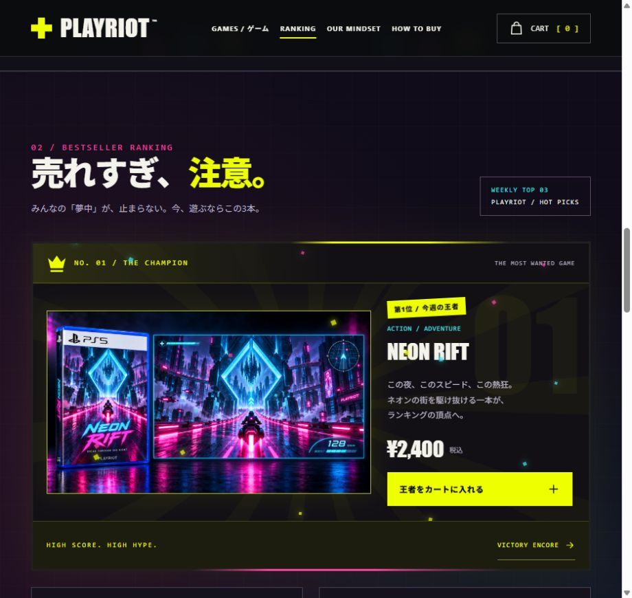

# PLAYRIOT

An original game-shop concept with a neon arcade atmosphere, Japanese copy, generated artwork, and a spectacular animated first view.

**[Visit the website](https://kenkenta51-max.github.io/playriot/)**

## Features

- Animated controller hero, original pixel drones, laser effects, and a boost interaction.
- Three fictional games with titled PS5 package concepts and gameplay visuals.
- Product search, genre filters, details, favorites, and a demo shopping cart.
- Bestseller ranking with a crowned first place, animated neon border, light rays, and pixel confetti.
- Shop philosophy and a three-step illustrated buying guide.
- Responsive layouts, keyboard navigation, animation controls, and reduced-motion support.

## Run locally

Open `index.html` in a browser. CSS, JavaScript, and all artwork are embedded in this single HTML file; no build step or dependencies are needed.

This is a fictional shop demonstration. The games, gameplay imagery, and ranking are concepts. No payment, shipping, game downloads, or email submissions take place. Cart and favorites are stored locally in the browser.

The reference inspired the colors, geometric forms, and arcade mood. Its original product name, logo, and characters were not copied. PlayStation/PS5 package marks appear only in fictional package concepts.
